<h1 align="center">Hi, I'm Fernando 👋</h1>

<p align="center">
  <a href="https://github.com/felisfer">
    
  </a>
</p>

<p align="center">
  <a href="https://www.linkedin.com/in/jose-fernando-espinosa-salinas/"></a>
  <a href="mailto:fernando.es.0218@gmail.com"></a>
  <a href="https://me.felisfer.com"></a>
  <a href="https://status.felisfer.com"></a>
  
</p>

---

## 🧑‍💻 About me

```yaml
name: José Fernando Espinosa Salinas
role: Computer Engineering Student (final year) @ UAEMéx
location: Toluca, Mexico
focus: [Backend, DevOps & DevSecOps, Embedded Systems / IoT]
currently_learning: Cloud IoT pipelines (MQTT on AWS IoT Core) and predictive models with Python
looking_for: Software engineering internship — backend / DevOps
fun_fact: I run my own homelab server named "felis" — rootless Docker, Cloudflare Tunnel, Tailscale
```

## 🛠️ Tech Stack

**Languages & Frameworks**
<p>
  
</p>

**Databases & Infrastructure**
<p>
  
</p>

**Embedded & Computer Vision**
<p>
  
</p>

## 🚀 Featured Projects

| Project | Description | Stack |
|---|---|---|
| [**nomina-distribuido**](https://github.com/felisfer/nomina-distribuido) | Distributed payroll system with JWT auth, multi-repo CI/CD and automated security scanning (CodeQL, Gitleaks). | Spring Boot · Next.js · PostgreSQL · GitHub Actions |
| [**robot-deteccion-y-control**](https://github.com/felisfer/robot-deteccion-y-control) | Computer-vision-guided robotic arm: OpenCV shape detection with homography mapping, driving a 4-servo ESP32-S3 arm via inverse kinematics. | ESP32-S3 · OpenCV · Python · WebSockets |
| [**serverless-demos**](https://github.com/felisfer/serverless-demos) | Three AWS Lambda demos: Function URL basics, a task REST API (API Gateway + DynamoDB) as infrastructure-as-code, and an S3-triggered thumbnail generator exploring cold starts and concurrency. | AWS Lambda · SAM · DynamoDB · S3 · Node.js |
| [**pulso-seguro**](https://github.com/felisfer/pulso-seguro) | IoT wristband for vital-sign monitoring and fall detection, with TFT display and web dashboard. | ESP32 · MAX30102 · MPU6050 · Web |

## 🏗️ What I'm up to

- 🔐 Hardening my self-hosted stack: LUKS, SSH hardening, Caddy + Cloudflare Tunnel for public services, Tailscale for private ones
- ⚙️ Building DevSecOps pipelines: Trivy scans, cosign image signing, GHCR publishing
- 📡 Connecting ESP32 sensor data to the cloud for predictive analysis

## 📊 GitHub Stats

<p align="center">
  
  
</p>

<p align="center">
  
</p>

<p align="center">
  
</p>

---

<p align="center">
  <i>From servo motors to servers — I like building things end to end.</i>
</p>
